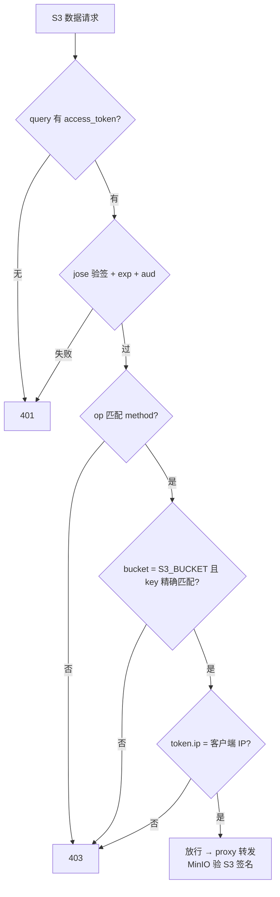

# auth · 设计稿

> 日期：2026-11-23 · 状态：**设计已收口，未落码**
> 上游：[AGENTS.md](../../../AGENTS.md) §4.4（已按本轮拍板同步）；handoff 接口稿 §四 的 forward_auth / 「token 明文不算 HMAC」/ x-kc-token 私有命名均属旧口径，**以本文为准**。
> 下游：实现前先读本文件 → 同目录产出 `spec.md` → 按 spec 落码。
> 依赖方：presign（签发时调本模块铸 token）、proxy（数据面每请求过闸）、oci（bearer 验 scope）、multipart（signPart 复用 put token）。

---

## 〇 · 职责与边界

网关即闸：鉴权**内联在每个请求**，无 forward_auth 子请求。auth 模块做四件事：

1. **通用 token 服务**：标准 JWT（RFC 7519，jose 库 HS256）的铸造 / 校验。浏览器数据面与 OCI bearer 是**同一套代码、不同 claim profile**，不造项目私有 token 协议。
2. **IP 绑定闸**：数据面 token 绑签发时浏览器 IP，换网络即拒（立项核心）。
3. **service token**：服务间静态凭证（后端 / D1 / D2），控制面与 `/objects/*` 用。
4. **OCI bearer 端点**：`GET /token` 签发 + scope 裁剪。

不做：**吊销**（已拍不做，见 §五）、对象级授权（判据在业务 `resources`）、限流与审计落盘（ops 的事，auth 只产出身份事实）、S3 签名校验（MinIO 的事）。

## 一 · 三类调用方 × 凭证

| 调用方 | 凭证 | 过闸端点 | 验什么 |
|---|---|---|---|
| 浏览器 | presigned URL 内嵌 `access_token`（JWT） | S3 数据面 `/<bucket>/<key>` | 签名 / exp / aud / op / 路径归属 / **IP** |
| 后端 / D1 / D2 | service token（静态） | `/presign/*` `/objects/*` multipart 控制 | token 匹配 → 服务身份 |
| OCI client（oras / D1 / D2） | bearer（`/token` 换发，也是 JWT） | `/v2/*` | 签名 / exp / aud / scope ⊇ 请求所需 |

**配对硬约束**：`/presign/*` 必须过 service gate——否则攻击者自签一个绑自己 IP 的 URL 就绕过 IP 闸（handoff §四已点名）。

## 二 · 通用 token 服务（已定：标准 JWT）

### 2.1 一套核心、两个 profile

`token.ts` 只有一对原语：`issueToken(profile, claims)` / `verifyToken(token, expectedAud)`，jose HS256，密钥 `TOKEN_SECRET`（只在网关）。**`aud` claim 区分用途，跨用即 401**——OCI bearer 打数据面、数据面 token 打 `/v2/*` 都不成立。

| claim | 数据面 profile（`aud:'data-plane'`） | OCI profile（`aud:'registry'`） |
|---|---|---|
| `sub` | 终端用户标识（业务后端传入） | 服务名 |
| `jti` | 随机 UUID（**只作审计关联**，无吊销表） | 随机 UUID |
| `exp` | 签发时刻 + expiresIn | 签发时刻 + 300s |
| `aud` | `'data-plane'` | `'registry'` |
| `resource_id` | 业务资源 id（只进审计，网关不查库） | — |
| `key` | 签发时绑定的对象 key | — |
| `op` | `'put' \| 'get'` | — |
| `ip` | 签发时浏览器 IP | — |
| `grants` | — | `[{ name, actions }]` |

数据面细则：

- 单桶网关：bucket 不进 token，请求路径里的 bucket 必须等于 `S3_BUCKET`。
- op 匹配：put→PUT；get→GET/HEAD。multipart 分片 PUT（`?partNumber&uploadId`）复用同 key 的 put token，query 不影响路径归属。
- DELETE 不发数据面 token：删除只走 `/objects/delete`（service token）。
- 签发与校验同进程同密钥 → **不做时钟容差**。

### 2.2 传输（已定：统一 query）

- presign 时把 `access_token=<jwt>` 作为 **query 参数**签进 URL（RFC 6750 §2.3 URI Query Parameter 方式；SigV4 签全部 query，篡改即破签名）。
- 理由：下载走 302，浏览器原生导航带不了自定义头，GET 必然 query；PUT 统一后只有一条注入路径，且免 CORS 预检。
- 代价（接受）：token 进 URL → **日志脱敏必须剥掉 `access_token` 与 `X-Amz-*`**（§六红线，ops 执行）；RFC 6750 本身也提示该方式有泄露面，靠脱敏 + 短 TTL 压住。

### 2.3 IP 绑定闸

- **签发侧**：后端调 `/presign/*` 带 `client_ip`（浏览器 IP，不是后端自己的）；缺失 → presign 400。IP 闸是立项核心，**不存在「不绑 IP」的签发路径**。
- **校验侧**：`token.ip` vs 当前客户端 IP，规范化后精确相等，不一致 **403**。
- **客户端 IP 提取**（`client-ip.ts`）：
  - TCP peer 来自 `c.env.incoming.socket.remoteAddress`（@hono/node-server 的 Node bindings）。
  - `TRUSTED_PROXIES`（env，IP/CIDR 逗号列表，默认空 = 谁都不信）：peer ∈ 可信集合时，从 `X-Forwarded-For` **右往左找第一个不可信 IP**；peer 不可信时直接用 peer，**绝不看客户端自带的 XFF**。
  - `::ffff:a.b.c.d` 映射地址规范化为 IPv4；可信代理但 XFF 缺失/全可信 → 取不到客户端 IP → 403。
- 已知代价（接受）：NAT 同出口拦不住（拦「换网络」不拦「换人」）；合法切网被拦，出口 = 业务后端重新 presign。
- **开关（已定）**：`IP_GATE_ENABLED` 默认 `true`；`false` 时流水线跳过 IP 比对节点，**启动日志告警「IP 闸已禁用」**。presign 的 `client_ip` 必填契约不变（token 仍带 ip，只是不比对）——开关不改契约，只改校验。

### 2.4 校验流水线（S3 数据面每请求）



错误语义定死：**401 = 凭证不成立**（缺失 / 格式坏 / 签名坏 / 过期 / aud 错）；**403 = 凭证成立但越权**（op / 路径 / IP）。

## 三 · service token

- env `SERVICE_TOKENS` = `name:token` 逗号列表（如 `backend:…,d1:…,d2:…`）；name 即审计身份。token 字符集限 `[A-Za-z0-9_-]{32,}`（不含逗号冒号，避免解析歧义），启动时解析校验，不合法拒启。
- 传输：`Authorization: Bearer <token>`。
- 校验：遍历表做 `crypto.timingSafeEqual`（长度不等直接 false）；命中 → 身份 `{ kind:'service', name }`。
- 静态凭证、无过期：轮换 = 改 env 重启（内网 Tailscale 面，接受）。限流按身份归 ops。

## 四 · OCI bearer（`GET /token`）

标准 Docker/OCI token 流，oras 原生兼容（**`OCI_ENABLED=false`（默认）时 `/token` 与 `/v2/*` 均不挂**）：

1. 无 bearer 打 `/v2/*` → `401` + `WWW-Authenticate: Bearer realm="<S3_PUBLIC_ENDPOINT>/token",service="better-minio",scope="repository:<name>:<actions>"`（scope 按当前请求补）。
2. client 带 `Authorization: Basic base64(name:serviceToken)` 调 `GET /token?service=…&scope=repository:<name>:<actions>`（scope 参数可多个）。
3. 网关验 Basic（复用 service token 表）→ 按服务授权裁剪 scope → 铸 bearer（`aud:'registry'`）返回 `{ token, expires_in: 300 }`。

- **push 授权（已定）**：env `OCI_PUSH_SERVICES` 白名单，默认 `d1`——白名单内服务可获 `pull,push`，其余认证服务只 `pull`，无匿名 pull。
- scope 校验：`name` 按 distribution 正则 `[a-z0-9]+([._-][a-z0-9]+)*(/[a-z0-9]+([._-][a-z0-9]+)*)*`；actions ⊆ {pull, push}；请求所需 ⊄ grants → `403 INSUFFICIENT_SCOPE`（distribution 错误体）。
- `service` 参数 ≠ `better-minio` → 400；Basic 缺失/坏 → 401。

## 五 · 吊销：不做（已拍）

- 数据面 token 与 OCI bearer 均为**无状态 JWT，签发后到 exp 自然失效**，网关不持任何 denylist。
- 后果（接受）：链接泄露只能等 TTL 到期；缓解 = 短 TTL（建议按文件大小来决定，由 presign 侧约束）。
- 未来若出现真实吊销需求（封号 / 泄露应急），再立设计加 denylist；持久化走 §六 的 Redis/内存约定，届时不破坏现有契约。
- AGENTS.md 原「jti 吊销」条目与验收已同步删除；`jti` claim 保留，仅用于审计关联。

## 六 · 跨模块共享约定（已定，后续模块直接引用）

1. **状态持久化（已定）**：可选 Redis——env `REDIS_URL` 给了就连它持久化，**不给就全存内存**（重启丢，显式接受）。启动时给了 `REDIS_URL` 但连不上 → 拒启（显式配置必须生效，不静默降级）；运行期断连走客户端自动重连。客户端库用 `ioredis`。key 统一 `better-minio:<module>:…` 命名空间。**适用域 = 瞬态**（multipart 会话、oci 上传会话、限流计数）；**持久 registry 状态（oci tag 索引）落 MinIO 对象**（oci D1 已定：无 Redis 重启 tag 不丢）。auth 本身无状态，不碰 Redis。
2. **core 错误口径**：`GatewayError { code: string, httpStatus: number, message: string }`；auth 的 code：`E_TOKEN_MISSING / E_TOKEN_INVALID`（401）、`E_OP_MISMATCH / E_PATH_MISMATCH / E_IP_MISMATCH`（403）、`E_SERVICE_TOKEN`（401）、`E_SCOPE`（403）。**渲染归各面**：S3 数据面回 S3 XML（`AccessDenied` 等，SDK 才认）、控制面回 JSON `{code,message}`、`/v2/*` 回 distribution 错误体。auth 只抛类型化错误，不碰响应格式。
3. **身份事实**：过闸产物统一 `Identity = { kind:'browser', sub, resourceId, jti, op, key, ip } | { kind:'service', name }`，挂 `c.set('identity', …)`；ops 审计从它取 who，不另解析。
4. **脱敏红线**（ops 执行，auth 声明）：`access_token` 整条（JWT 含 ip/sub）、`X-Amz-*` query、Authorization 头、service token 值，一律不进日志。

## 七 · 模块接口（文件级草图，spec 阶段定签名）

```
src/auth/
  token.ts        issueToken / verifyToken（jose HS256，aud 区分 profile）
  service-token.ts  parseServiceTokens(env) / verifyServiceToken(header)
  scope.ts        parseScope(raw) / authorizeScope(identity, requested)
  client-ip.ts    resolveClientIp(remoteAddress, xff, trustedProxies)
  gate.ts         dataPlaneGate / serviceGate / ociGate   ← Hono middleware 工厂
  routes.ts       GET /token
```

- 闸是**工厂函数返回 middleware**，proxy / presign / oci 挂路由时内联使用；auth 不拥有数据面路由本身。
- 配置新增：`TOKEN_SECRET`（必填，≥32 字符）、`SERVICE_TOKENS`（必填）、`TRUSTED_PROXIES`（默认空）、`OCI_PUSH_SERVICES`（默认 `d1`）、`IP_GATE_ENABLED`（默认 `true`）。全部进 `config.ts`，密钥不打印。
- 新增依赖：`jose`。

## 八 · 验收

1. 换 IP：同 token 从另一 IP 打数据面 → 403；不可信 peer 伪造 XFF 不影响判定。
2. 过期 / 篡改（改一个字符）/ 缺失 / aud 跨用 → 401。
3. op 错配（get token 打 PUT）→ 403；路径错配（token.key ≠ 请求 key）→ 403。
4. service token：对的过、错的 401、`/presign/*` 无 service token 进不来。
5. OCI：无 bearer 401 带 challenge；Basic 换 token 通；d2 要 push scope 被裁；scope 不足 403 INSUFFICIENT_SCOPE；oras push/pull 全链路通（与 oci 模块联测）。
6. 日志 / 错误体不含 token 值、JWT、MinIO 地址。

## 九 · 决策清单（全部收口）

| # | 决策 | 结论 | 状态 |
|---|---|---|---|
| D1 | token 机制 | 标准 JWT（jose HS256），通用 token 服务、aud 分 profile，不造私有协议 | **已定** |
| D2 | 传输位置 | 统一 query `access_token`（RFC 6750 §2.3，签进 URL） | **已定** |
| D3 | 吊销 | 不做；TTL 自然过期，短 TTL 缓解；未来有需求再立设计 | **已定** |
| D4 | service token 形状 | env `name:token` 列表 + Bearer + timingSafeEqual | **已定**（默认通过） |
| D5 | OCI push 授权 | env `OCI_PUSH_SERVICES` 白名单，默认 `d1` | **已定** |
| D6 | 共享约定 | 可选 Redis（无则全内存）/ core 错误 / Identity / 脱敏，§六整包 | **已定** |
| D7 | IP 闸开关 | `IP_GATE_ENABLED` 默认 true，可关（启动告警）；client_ip 契约不变 | **已定**（2026-11-23） |

## 十 · 与上游文档的差异

- AGENTS.md §4.3/§4.4：**已同步**（x-kc-token → 标准 JWT access_token；jti 吊销删除）。
- handoff 接口稿（历史稿，不改）：forward_auth / Caddy 数据面反代已废；「token 明文不算 HMAC」已废；x-kc-token 命名已废。