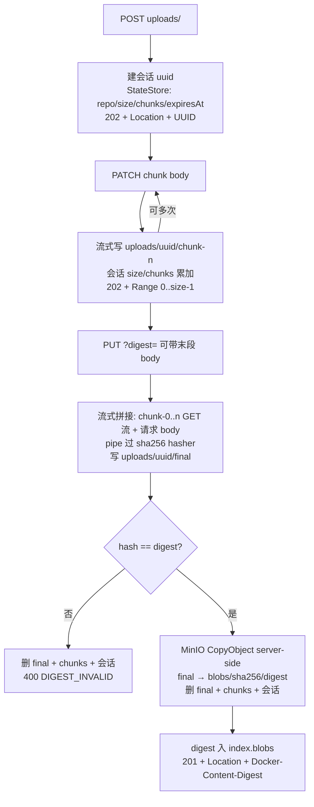

# oci · 设计稿

> 日期：2026-11-23 · 状态：**设计已收口，未落码**
> 开关：`OCI_ENABLED` 默认 **`false`**（2026-11-23 拍板：镜像最小核心出厂）；`false` = `/v2/*` 与 `/token` 不挂、chunk 清理不起、registry 桶不建。kcplan 使用者 compose 里显式开启。
> 上游：[AGENTS.md](../../../AGENTS.md) §4.6；[auth 设计](../../auth/design/design.md)（ociGate / `/token` / push 白名单）；[两 domain .kcplan 契约](../../../../../_Agents/handoff/design-2026-11-23-two-domain-kcplan.md)。
> 下游：实现前先读本文件 → 同目录产出 `spec.md` → 按 spec 落码。

---

## 〇 · 职责与边界

**通用 OCI Distribution registry**，存储后端 MinIO。讲公开标准，oras / crane / 各语言 OCI 客户端通用。

- 做：`/v2/*` 标准端点、manifest/blob 内容寻址存储、tag 索引、流式 blob 上传（digest 校验）、distribution 错误体。
- **不做 `.kcplan` 语义校验**：config/layer 的 `application/vnd.kc.plan.*` mediaType 对网关只是不透明 descriptor；annotations 原样存。`.kcplan` 映射（manifest.json/plan.json/assets）是 D1/D2 的事，网关是通用制品库，不绑 kcplan。
- 不做：文件元数据、对象级授权（scope 级鉴权归 auth）、跨 repo blob mount / Referrers API / `_catalog`（D6，oras 有合规降级路径）。
- 调用方：D1 push（service `d1`，白名单内可 push）、D2 pull（`d2`，只 pull）、oras 调试。

## 一 · 端点面（OCI Distribution Spec）

| 端点 | 方法 | scope | 说明 |
|---|---|---|---|
| `/v2/` | GET | — | 有 bearer 200 `{}`；无 → 401 + WWW-Authenticate challenge（auth 提供） |
| `/v2/<name>/manifests/<ref>` | HEAD/GET | pull | ref = tag 或 digest |
| `/v2/<name>/manifests/<ref>` | PUT | push | 推 manifest（tag 或 digest 指定） |
| `/v2/<name>/manifests/<ref>` | DELETE | push | 删 manifest / 摘 tag，202 |
| `/v2/<name>/blobs/<digest>` | HEAD/GET | pull | 流式 |
| `/v2/<name>/blobs/<digest>` | DELETE | push | 解链，202（对象删除归 GC） |
| `/v2/<name>/blobs/uploads/` | POST | push | 开上传会话，202 + Location + Docker-Upload-UUID |
| `/v2/<name>/blobs/uploads/<uuid>` | PATCH | push | 追加 chunk，202 + Range |
| `/v2/<name>/blobs/uploads/<uuid>?digest=` | PUT | push | 收尾（可带最后一段 body），201 |
| `/v2/<name>/blobs/uploads/<uuid>` | DELETE | push | 取消，204 |
| `/v2/<name>/tags/list` | GET | pull | `{name, tags}` |

- `name` 按 distribution 正则校验（auth scope 同规则）；`kcplan/<app>` 是业务约定，网关不强制前缀。
- 错误体统一 distribution 格式 `{"errors":[{code,message,detail?}]}`，HTTP 状态按 spec（§五）。

## 二 · 存储布局（MinIO，D4）

**独立 registry 桶** `S3_REGISTRY_BUCKET`（默认 `kcregistry`，启动 ensureBucket），与业务文件桶分离：

```
blobs/sha256/<hex>          blob 与 manifest 对象（内容寻址，不可变，If-None-Match:* 写入）
repos/<name>/index.json     每 repo 一个索引对象（registry 状态，D1）
uploads/<uuid>/chunk-<n>    上传会话临时 chunk（收尾/取消/过期即清）
uploads/<uuid>/final        收尾临时对象（hash 校验后 CopyObject 进 blobs/，即删）
```

### 2.1 tag 索引落点（D1，本轮核心决策）

| 选项 | 做法 | 代价 |
|---|---|---|
| **A MinIO 对象（推荐）** | `repos/<name>/index.json`，If-Match 条件写 + 进程内 repo 锁 | 每次 push 一读一写（D1 低频，可接受）；**无 Redis 重启 tag 不丢** |
| B Redis/内存 | 跟「不给 Redis 全内存」策略字面走 | **无 Redis 重启 = 全部 tag 丢光**：blob 都在但 registry 看起来空了，D2 拉不到制品 = 部署链断； durability 取决于有没有配 Redis |

推荐 A 的理由：索引是**持久 registry 状态**（tag→digest 映射），不是传输会话——与 multipart 会话「可丢可重建」性质不同；blob 本来就住 MinIO，索引同桶不引入新基础设施；「网关无 DB」原则不破（MinIO 就是它的存储）。**Redis/内存策略的适用域收窄为瞬态**（上传会话、限流计数）；持久状态（tag 索引）落 MinIO。选 A 则 auth 设计 §六.1 共享约定同步细化。

索引形状：

```jsonc
{ "tags": { "1.2.0": "sha256:…" },
  "manifests": { "sha256:…": { "mediaType": "…", "size": 1234 } },
  "blobs": [ "sha256:…", … ] }        // manifest PUT 时把 config+layers digest 记入（repo 级 blob 关联）
```

- 读改写：进程内 per-repo 串行 + `If-Match: <etag>` 条件写，冲突重试 ≤3。单实例低频，足够。
- blob 全局共享（同 digest 跨 repo 一个对象），**repo 级访问判据 = digest ∈ index.blobs**（blob GET/HEAD 先查本 repo 索引）。

## 三 · manifest 流程

### 3.1 PUT（push）

1. body 小（≤4MB，spec 上限）可缓冲；parse + 结构校验：`schemaVersion:2`、mediaType ∈ {OCI image manifest, Docker manifest v2}、config/layers descriptor 齐全、digest 格式合法。
2. **引用完整性**：config + 每个 layer 的 digest 必须已在本 repo（index.blobs）→ 缺 → 400 `MANIFEST_BLOB_UNKNOWN`。
3. 算 manifest bytes 的 sha256；ref 是 digest 时必须相等 → 不等 400 `DIGEST_INVALID`。
4. 写对象 `blobs/sha256/<digest>`（`If-None-Match:*`，已存在即幂等跳过）。
5. 更新索引：manifests[digest] + config/layers 入 blobs；ref 是 tag → tags[tag]=digest（**tag 不可变，D2**：同 digest 幂等 201；异 digest → 409 `TAG_INVALID`）。
6. 201 + `Location` + `Docker-Content-Digest`。

### 3.2 GET/HEAD

tag → index.tags 解析 digest；digest → 查 index.manifests。对象流式回（manifest 小，直接回）；`Content-Type` = 存的 mediaType，`Docker-Content-Digest` 头。不存在 → 404 `MANIFEST_UNKNOWN` / `NAME_UNKNOWN`（repo 无索引）。

### 3.3 DELETE

- ref=digest：摘 manifests[digest] + 所有指向它的 tag；对象删除归 GC。202。
- ref=tag：只摘 tag。202。

## 四 · blob 上传（流式 + digest 校验，D3）

**禁 buffer**（layer 可达几十 MB，2G 内存）。S3 对象不可追加 ⇒ PATCH chunk 各存独立对象，收尾流式拼接：



- **为什么临时 key + CopyObject**：直接写 `blobs/<digest>` 会让未校验内容短暂可 pull；CopyObject 是 MinIO 服务端复制（数据不过网关），校验通过才进内容寻址区。spike：CopyObject 同桶实测。
- blob 已存在（HEAD 命中）→ 跳过复制，清临时、链入 repo，仍 201（幂等）。
-  monolithic（POST 后直接 PUT 带全 body，无 PATCH）：chunks=0，拼接 = 仅请求 body，同路径。
- GET blob：index.blobs 判据 → 对象流式 pipe 回，`Docker-Content-Digest` + `Content-Length`；Range 请求透传 MinIO（206）。
- DELETE blob：只摘 index.blobs 链，202；**对象不删**（跨 repo 共享，删除归 GC mark-sweep）。
- 会话 TTL：env `OCI_UPLOAD_TTL` 默认 3600；StateStore（Redis/内存）存会话头，**chunk 清单不另存**——收尾按会话 chunks 计数顺序读对象（与 multipart「真源在 MinIO」同构）。过期清理定时器扫会话 → 删 chunks。
- 无 Redis 重启：上传会话丢 → 孤儿 chunk 由 `uploads/` 前缀扫（对象 lastModified 超 TTL 即删）兜底。

## 五 · 错误映射（distribution spec）

| 场景 | HTTP | code |
|---|---|---|
| 无/坏 bearer | 401 | `UNAUTHORIZED`（+ challenge） |
| scope 不足 | 403 | `DENIED`（auth 的 INSUFFICIENT_SCOPE 渲染为此） |
| repo 不存在 | 404 | `NAME_UNKNOWN` |
| manifest 不存在 | 404 | `MANIFEST_UNKNOWN` |
| blob 不存在 | 404 | `BLOB_UNKNOWN` |
| digest 不符 | 400 | `DIGEST_INVALID` |
| manifest 结构坏 / 超 4MB | 400 | `MANIFEST_INVALID` |
| 引用 blob 缺 | 400 | `MANIFEST_BLOB_UNKNOWN` |
| tag 异 digest 重推 | 409 | `TAG_INVALID` |
| mediaType 不支持 | 415 | `UNSUPPORTED` |
| MinIO 上游失败 | 502 | `UNKNOWN`（message 通用，不泄地址） |

## 六 · GC（D5）

- **上传 chunk 清理：实现**（会话过期扫 + `uploads/` 前缀孤儿扫，§四）。
- **悬挂 blob GC：触发点，先不做**（AGENTS.md 原定）。设计草图留档：mark = 遍历所有 repo index.blobs 并集；sweep = `blobs/` 前缀中不在 mark 集的对象删除；手动触发端点 `POST /v2/_gc`（service token，backend 身份）。低频人工触发即可，不做定时。

## 七 · 模块接口与装配

```
src/oci/
  routes.ts     mountOci(app, deps)：/v2/* 全端点，内联 ociGate（pull/push 按方法）
  manifest.ts   put/get/head/delete + 结构校验 + 引用完整性
  blob.ts       get/head/delete + repo 链判据
  upload.ts     POST/PATCH/PUT/DELETE 会话 + 流式 hash + CopyObject 收尾
  index.ts      per-repo 索引读改写（If-Match 重试 + 进程锁）
  errors.ts     distribution 错误渲染
  gc.ts         chunk 清理定时器（+ 悬挂 blob GC 草图注释，不实现）
src/api/objects.ts  补 copyObject 原语（server-side copy）
```

- deps = `{ internalClient, registryBucket, stateStore, ociGate, serviceGate }`。
- 配置新增：`S3_REGISTRY_BUCKET`（默认 `kcregistry`）、`OCI_UPLOAD_TTL`（默认 3600）、`OCI_ENABLED`（默认 `false`，严格布尔）。
- 无新增库（sha256 用 node:crypto；OCI 协议端点手写路由——协议是公开标准但无 Node 服务端库，客户端库 oras 只做验收工具）。
- spike 清单：① MinIO CopyObject 同桶 server-side；② oras push 真实分块行为（PATCH 尺寸/次数）；③ 流式拼接 + hash 内存平稳。

## 八 · 验收

1. `oras push` 一个 .kcplan 制品（config + layer + annotations + tag）→ 201 全链路；`oras pull` 按 tag 与按 digest 均还原一致（SHA-256）。
2. blob 上传 digest 篡改 → 400 `DIGEST_INVALID`，临时对象清干净。
3. 分块 PATCH（oras 真实行为）→ 收尾合并 hash 一致；monolithic 同通。
4. tag 解析：tags/list 正确；异 digest 重推同 tag → 409；同 digest 幂等 201。
5. 错误体符合 distribution 格式（§五表逐条）。
6. **无 Redis 重启后 tag/manifest/blob 全在**（索引在 MinIO，D1 选 A 时）；上传会话丢但孤儿 chunk 被清。
7. d2 push → 403 DENIED；无 bearer → 401 challenge；跨 repo 拉未链 blob → 404。
8. 大 layer（≥100MB）推拉内存平稳。
9. 日志不含凭证 / 完整 presigned URL（OCI 面不涉及 presign，但 bearer 值不记）。

## 九 · 决策清单

| # | 决策 | 结论 | 状态 |
|---|---|---|---|
| D1 | tag 索引落点 | A：MinIO 对象（持久 registry 状态）；Redis/内存策略适用域收窄为瞬态 | **已定**（2026-11-23） |
| D2 | tag 可变性 | 不可变（制品语义）：同 digest 幂等、异 digest 409 | **已定**（2026-11-23） |
| D3 | blob 收尾机制 | 临时 key + 流式 hash + CopyObject（未校验内容不进内容寻址区） | **已定**（默认通过） |
| D4 | registry 桶 | 独立 `kcregistry`（env 可改），与业务桶分离 | **已定**（默认通过） |
| D5 | GC | chunk 清理实现；悬挂 blob GC 触发点先不做（草图留档） | **已定**（默认通过） |
| D6 | 可选面 | mount / Referrers / `_catalog` 不做（oras 合规降级） | **已定**（默认通过） |
| D7 | 功能开关 | `OCI_ENABLED` 默认 false（最小核心出厂）；关 = /v2 与 /token 不挂、桶不建 | **已定**（2026-11-23） |

## 十 · 与上游文档的差异（spec 阶段同步回写）

- AGENTS.md §4.6：存储布局细化（blobs/repos/uploads 前缀 + registry 桶）；tag 索引维持 MinIO 对象（D1 选 A 则与原文一致）；补 tag 不可变、blob 跨 repo 共享、GC 分档。
- auth 设计 §六.1：Redis/内存策略适用域细化为「瞬态会话/计数」，持久 registry 状态落 MinIO（D1 选 A 时）。
- handoff 接口稿「registry 索引落 MinIO vs 轻表」开放项：收口为 MinIO 对象，无新基础设施。