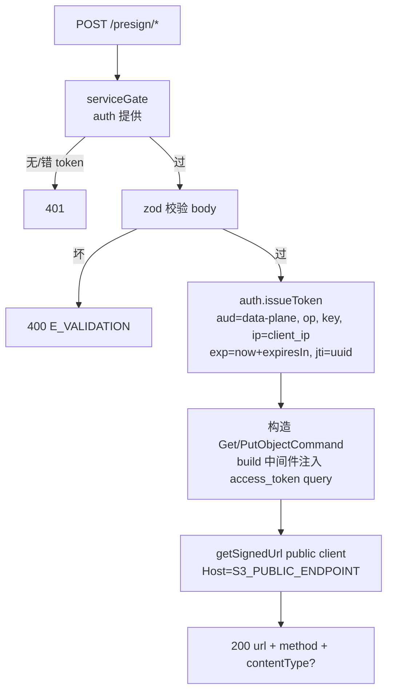

# presign · 设计稿

> 日期：2026-11-23 · 状态：**设计已收口，未落码**
> 上游：[AGENTS.md](../../../AGENTS.md) §4.3；[auth 设计](../../auth/design/design.md)（token 契约已收口，本模块直接消费）。
> 下游：实现前先读本文件 → 同目录产出 `spec.md` → 按 spec 落码。
> 实物依据：[api/presign.ts](../../api/presign.ts)（原语已落）、[api/object-store.ts](../../api/object-store.ts)（类型/TTL 边界已落）；「签名前注入自定义 query」手法 2026-10-29 已实测（build 步骤中间件改 `args.request.query`，签名覆盖它；签后追加 → 403）。

---

## 〇 · 职责与边界

签发控制面：**只有业务后端能调**（service gate），本地签名、不发网络。把「MinIO 凭证签名」与「网关身份 token」合成一条 presigned URL 交给浏览器。

- 做：请求校验、铸数据面 JWT、注入 `access_token` query、用 public client 签 URL、回传 URL。
- 不做：key 生成（业务后端的事）、对象级授权（业务判据）、文件元数据、CORS（控制面无浏览器调用方；数据面 CORS 归 proxy）、吊销（auth 已定不做）。
- **不知道文件名**：`resources` 元数据在业务 PG，网关只认 key。下载要的 `attachment; filename*=…`（RFC5987）**整条值由业务传入**，网关不造文件名。

## 一 · 端点与请求契约

### 1.1 `POST /presign/put`

```jsonc
// 请求（* 必填）
{
  "key": "resources/2026/11/abc123.pdf",  // * 业务生成的对象 key
  "expiresIn": 300,                        // * 秒，1–604800
  "client_ip": "203.0.113.7",              // * 浏览器 IP（不是后端 IP）——IP 闸的锚
  "sub": "user-or-session-id",             // * 终端主体标识，网关 opaque（见 D1）
  "resource_id": "res_…",                  // 可选，只进审计
  "contentType": "application/pdf"         // 可选；给了就签进 SignedHeaders
}
// 响应 200
{ "url": "https://…/kbfile/resources/…?access_token=…&X-Amz-…", "method": "PUT", "contentType": "application/pdf", "key": "resources/2026/11/abc123.pdf" }
```

`key` **恒回实际对象 key**（flat 模式回显请求值；date 模式回加前缀后的值，见 §二·二）——后端统一用它建 data_uri，不做模式分支。

### 1.2 `POST /presign/get`

```jsonc
{
  "key": "…", "expiresIn": 3600, "client_ip": "…", "sub": "…",   // * 同上
  "resource_id": "…",                                            // 可选
  "responseContentDisposition": "attachment; filename*=UTF-8''…", // 可选，整条透传
  "responseContentType": "application/pdf",                       // 可选
  "responseCacheControl": "no-store"                              // 可选
}
// 响应 200
{ "url": "https://…?access_token=…&X-Amz-…", "key": "…" }
```

- `contentType` 回显给前端：签了 `signableHeaders: content-type` 后浏览器必须带**完全相同**的值，换类型 403（已实测）。
- 下载链路：业务 `GET /resources/:id/original` → 302 到本 URL（`no-store` 加在业务自己的 302 响应上）；浏览器原生导航，query 传 token 天然兼容（auth D2）。
- TTL：硬边界 1–604800（越界 400）；建议值上传 60–300 / 下载 3600 是业务侧选择，网关不强制建议值。
- multipart 的 signPart 后续复用同一条铸 token + 签名路径（op put、同 key），不在本模块开新端点。

## 二 · 签发流水线



要点：

1. **token 与 URL 同寿**：JWT `exp` = 签发时刻 + `expiresIn`，与 `X-Amz-Expires` 同值，不做两个旋钮。
2. **注入在签名前**：`command.middlewareStack.add(mw, { step:'build' })` 改 `args.request.query`（实测手法）。SigV4 签全部 query → token 篡改/删除都破签名；网关侧 JWT 自验再兜一层 401。
3. **public client 签名**：Host = `S3_PUBLIC_ENDPOINT`（浏览器实际打的地址）。签名是本地操作，不要求网关此刻连得上 MinIO。
4. PUT body 不签（`UNSIGNED-PAYLOAD`）；完整性靠业务上传后 stat 复核（既有决策）。checksum `WHEN_REQUIRED` 已在 client 配置。

## 二·二 · 可选：日期路径方案（`KEY_SCHEME`，D4 已定）

- env `KEY_SCHEME`：`flat`（默认）| `date`；严格枚举，非法拒启。compose `environment: KEY_SCHEME: date` 即开启。
- **date 模式**：`/presign/put` 与 multipart create 收的是 **base key**；网关加 `YYYY/MM/` 前缀（UTC，网关时钟）得实际 key → token 绑实际 key、URL 路径 = 实际 key、**响应回实际 key**。
- 为什么响应必须回 key：token 与路径闸精确绑定实际对象 key，网关加了前缀而不告知，后端拿请求 key 建 data_uri 就错位。**恒回 key（flat 回显）让后端契约无模式分支**。
- **撞名裁决仍归后端**：allocateKey 的随机后缀 + DB claim 不动；重试传新 base key，网关重新加前缀（跨月重试前缀可能变，无害——后端每次用返回值）。网关只做无状态前缀变换，不碰去重。
- GET / stat / delete **不变换**（既有对象，后端传完整 key）；旧对象不迁移（data_uri 单一真相）。
- 论据修正（2026-11-23）：ext3 的 32000 子目录限制在本部署不成立（MinIO Docker on ext4 + erasure set 散列）；日期前缀的真实收益 = 组织性 + lifecycle 按前缀过期。

## 三 · api 层扩展（唯一跨模块改动，D3）

现状 [api/presign.ts](../../api/presign.ts) 不支持自定义 query。两个放法：

| 选项 | 做法 | 代价 |
|---|---|---|
| **A 原语加 `extraQuery`（推荐）** | `ObjectPresignOptions` / `ObjectPresignPutOptions` 加 `extraQuery?: Record<string,string>`；原语内部挂 build 中间件注入 | api 层多一个通用能力；**现有调用方零变化**（可选字段，不传行为不变） |
| B presign 自挂中间件 | presign 模块自己构造 command、挂中间件、调 getSignedUrl | S3 command/中间件知识泄出 api 层，违反「api 是唯一碰 S3 的层」 |

推荐 A：注入是签名机制的一部分，住 api；presign 只传 `{ access_token: jwt }`。运行时对既有调用零变化。

## 四 · 校验与错误（控制面 JSON）

zod 在边界一次 parse（D2），规则：

| 字段 | 规则 |
|---|---|
| `key` | 非空、≤1024（S3 上限）、不以 `/` 开头、无控制字符 |
| `expiresIn` | 整数 1–604800 |
| `client_ip` | `node:net.isIP` 通过；`::ffff:` 映射规范化为 IPv4（与 auth 校验侧同规则）。**`IP_GATE_ENABLED=false` 时仍必填**（开关不改契约，token 仍带 ip） |
| `sub` | 非空字符串 ≤256 |
| `resource_id` | 可选，字符串 ≤256 |
| `contentType` / `response*` | 可选字符串；disposition 值不解析（业务全权） |

错误口径（auth §六 core 约定，控制面渲染 JSON `{code,message}`）：

- 校验失败 / 缺 `client_ip` / 缺 `sub` → **400 `E_VALIDATION`**（边界错误，不走 api 的 `E_OBJECT_STORE`）。
- service token 缺失/错 → 401 `E_SERVICE_TOKEN`（gate 抛）。
- 签名意外失败 → 500 `E_INTERNAL`，message 不含 MinIO 地址 / 凭证。
- **任何响应与日志不含完整 URL / token**（脱敏红线）；审计只记事实：`who=服务名, sub, key, op, ip, jti, exp`。

## 五 · 模块接口与装配

```
src/presign/
  schema.ts   zod schemas（put/get 两份）+ 规范化（client_ip）
  sign.ts     signPut / signGet：铸 token → extraQuery → 原语签名
  routes.ts   mountPresign(app, deps)：挂两端点，内联 serviceGate
```

- 装配（index.ts）：新建 **public S3 client**（`S3_PUBLIC_ENDPOINT`，其余配置同 internal）——现 index 只有 internal，注释已预留「public 随 presign 一起加」。deps = `{ publicClient, bucket, tokenService, serviceGate }`，工厂注入，不引 DI 容器。
- 新增依赖：`zod`。
- 配置：无新增（复用 `S3_PUBLIC_ENDPOINT` / `S3_BUCKET` / auth 的 `TOKEN_SECRET`）。

## 六 · 验收

1. 无/错 service token → 401；合法 → 200。
2. 缺 `client_ip` / 缺 `sub` / TTL 0 或 604801 / key 以 `/` 开头 → 400 `E_VALIDATION`。
3. 返回 URL：Host = `S3_PUBLIC_ENDPOINT`；query 含 `access_token` 与 `X-Amz-Signature`；`X-Amz-Expires` = expiresIn。
4. 联调（与 proxy/auth）：正确 Content-Type PUT 200；换类型 403；删掉/改写 `access_token` → 401（网关闸）；换 IP → 403；过期 → 401。
5. presignGet URL：Range 206；`responseContentDisposition` 原样出现在响应头。
6. 日志 / 错误体不含完整 URL、JWT、MinIO 地址。
7. `KEY_SCHEME=date`：put 响应 key 带 `YYYY/MM/` 前缀、URL 路径与 token.key 一致；flat 回显；GET 不变换；非法枚举值拒启。

## 七 · 决策清单

| # | 决策 | 结论 | 状态 |
|---|---|---|---|
| D1 | 请求契约与签发权 | `client_ip`/`sub` 必填、`resource_id` 可选；`sub` 网关 opaque（可信服务断言）。**网关铸 JWT（A 原案），任意 service token 可签发，不做身份收窄、不做后端签**——d1/d2 持 token 可为任意 sub/ip 铸币的宽度显式接受（内网 Tailscale 面，service token 泄露 = 全面失守，铸币宽度不额外放大风险） | **已定**（2026-11-23） |
| D2 | 校验库 | zod（边界一次 parse） | **已定** |
| D3 | query 注入位置 | A：api 原语加 `extraQuery`，S3 知识不泄出 api 层 | **已定** |
| D4 | 日期路径方案 | `KEY_SCHEME=date` 可选（默认 flat）；网关加 YYYY/MM 前缀、响应恒回实际 key；撞名裁决归后端；GET/stat/delete 不变换 | **已定**（2026-11-23） |

## 八 · 与上游文档的差异（spec 阶段同步回写）

- AGENTS.md §4.3：请求体补 `client_ip`/`sub`/`resource_id`；「注入 access_token」细化为 build 中间件手法；验收补 400 边界项。
- api 层：`extraQuery` 为可选扩展，既有 put/stat/get/delete/presign 调用方行为不变。